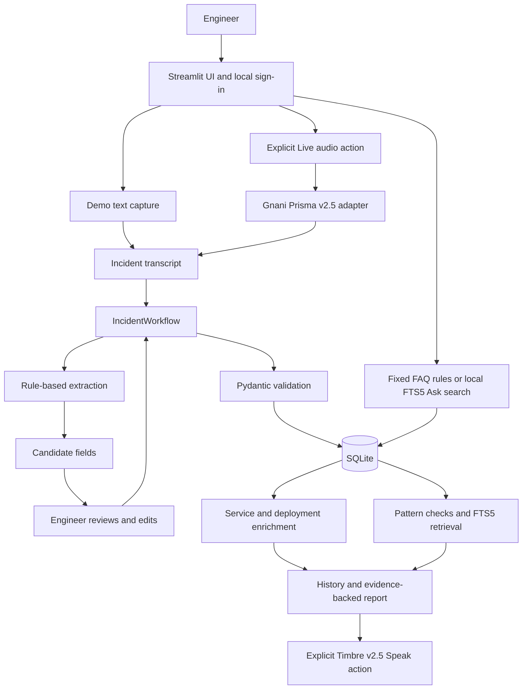

# OpsDiary

OpsDiary is a local-first incident capture and history tool for Hinglish-speaking SRE and on-call engineers. It turns a short incident note into a reviewable record, adds context from a local service and deployment catalog, and finds related records with their supporting evidence.

The project is an MVP for the Gnani AI Great Indian AI Internship Challenge. Voice services are optional. Demo mode works without an API key and uses synthetic data. OpsDiary does not predict outages, determine root cause, or change infrastructure.

## Current implementation status

| Component | Status |
| --- | --- |
| Local incident flow | Demo capture, extraction, human review, saving, enrichment, history, timeline, and reports are implemented. |
| Ask | Fixed FAQs and local FTS5 incident search are implemented. Questions and answers are saved in SQLite. |
| Authentication | One local account, Argon2id password hashes, offline recovery code, throttling, and expiring sessions are implemented. |
| Gnani integration | Prisma v2.5 and Timbre v2.5 adapters and explicit UI actions are implemented. Repository verification uses mocked provider responses; it does not establish live API behavior. |
| CI | Lint, dependency audit, unit/UI tests, and synthetic evaluation are configured. CI does not deploy the app. |
| Deployment posture | Local single-user MVP. It is not ready for network or production deployment. |

## What it does

| Area | Behavior |
| --- | --- |
| Incident capture | Start from synthetic text or, in Live mode, explicitly request transcription of a short WAV clip. |
| Review | Extract candidate service, environment, severity, symptoms, impact, and deployment version. The engineer can edit the fields before saving. |
| Service context | Match a confirmed service to the local catalog. Link a deployment only when service and environment match and the version matches after normalizing a leading `v` and letter case. The latest deployment is labeled as context, not as cause. |
| Historical context | Show deterministic service/environment/symptom matches and SQLite FTS5 lexical matches with record IDs, matched terms, and evidence snippets. |
| Incident updates | Store engineer-authored update, mitigated, and resolved events on the local timeline. These events do not trigger external actions. |
| Reports | View or download an incident brief with its reviewed fields and supporting records. |
| Ask | Answer greetings and common product questions with fixed local rules. Other questions search saved incident text and show matching evidence. Every question and answer is stored in SQLite. |
| Speech | In Live mode, explicitly request a spoken incident summary from Timbre and play the returned WAV audio. |

Ask does not call an LLM, Prisma, or Timbre. Its fixed answers and local search use no Gnani credits. Each submitted question and returned answer is stored in `assistant_interactions`, with the local username, timestamp, intent, source, trace ID, and evidence references. The Ask screen displays the latest 50 exchanges; the database retains all of them. Similar wording in historical records is evidence of a text match; it does not establish a shared cause or predict a future outage. Timbre reads the app's deterministic summary aloud; it does not create or validate the incident analysis.

## User workflow

### Demo

1. Register the one local account on first use, then sign in.
2. In **Incident**, run the built-in synthetic sample or enter/edit a synthetic Hinglish note.
3. Extract candidate fields, review or correct them, and save the incident.
4. Use **History** to search records, inspect enrichment and supporting matches, add timeline updates, or download a brief.
5. Use **Ask** for a fixed FAQ answer or to search saved incident text.

Demo is the default. It does not record audio or call Gnani. The built-in sample is reused when it already exists, so clicking it repeatedly does not create duplicate sample incidents.

### Live voice actions

Live mode appears only when `GNANI_API_KEY` is configured. Loading the page does not call Gnani. A request is sent only after the engineer presses **Transcribe audio**, **Transcribe update**, or **Speak summary**.

1. Record audio in the app or upload a WAV file up to 30 seconds and 10 MB.
2. Press **Transcribe audio** and review/edit the transcript.
3. Extract fields, review/edit them, and save the incident.
4. Press **Speak summary** to request Timbre speech and play the returned WAV.
5. In an incident timeline, record or upload a short update, explicitly transcribe it, review the text, select the event type, and save it.

Raw audio is held in Streamlit session memory for the request and is not written to disk by the app. Live audio is sent to Gnani after the explicit action. Provider contract tests are mocked; live calls have not been validated with this account's credentials. Live actions may consume credits.

## Architecture



| Layer | Implementation | Responsibility |
| --- | --- | --- |
| Presentation | Streamlit | Capture and review incident fields; display history, Ask answers, evidence, timeline, and reports. |
| Local access | `opsdiary.auth` | One-time local registration, sign-in, Argon2id password hashes, offline recovery code, throttling, and session expiry. |
| Application workflow | `opsdiary.workflow` | Coordinate extraction, validation, save, service enrichment, historical retrieval, timeline, and report assembly. |
| Extraction and validation | `opsdiary.extraction`, `opsdiary.schema` | Rule-based Hinglish field extraction and Pydantic checks. Extracted values remain candidates until reviewed. |
| Context and retrieval | `opsdiary.enrichment`, `opsdiary.patterns`, `opsdiary.retrieval` | Exact catalog matching, deterministic historical checks, and evidence-backed SQLite FTS5 search. |
| Ask | `opsdiary.assistant` | Fixed local FAQ responses and incident search; no generative model call. |
| Persistence | `opsdiary.storage` | SQLite schema, synthetic seed data, user records, incidents, timeline events, Ask exchanges, and FTS5 indexes. |
| Provider integration | `opsdiary.gnani_client` | Explicit REST calls to Prisma v2.5 and Timbre v2.5. No request runs at import or page load. |
| Operations and quality | `opsdiary.observability`, unit tests, evaluation, GitHub Actions | Structured stage logs, mocked provider contract checks, synthetic evaluation, lint, and dependency audit. |

More detail about trust boundaries and design choices is in [ARCHITECTURE.md](ARCHITECTURE.md).

## Technology

| Technology | Use |
| --- | --- |
| Python 3.12 | Application and test runtime. |
| Streamlit 1.67.0 | Local web UI. |
| SQLite with FTS5 | Local persistence and lexical search; no separate database server. |
| Pydantic 2.14.3 | Incident input validation. |
| argon2-cffi 25.1.0 | Argon2id password hashing. |
| Requests 2.34.2 | HTTP client for explicit Gnani calls. |
| python-dotenv 1.2.4 | Load optional local environment settings from the ignored `.env` file. |
| Ruff 0.17.3 | Static lint checks. |
| pip-audit 2.10.1 | Installed dependency vulnerability checks. |
| GitHub Actions and Dependabot | CI quality gates and dependency update proposals. |

Direct runtime and development dependencies are pinned in `requirements.txt` and `requirements-dev.txt`.

## Run locally

Requirements: Python 3.12 and [uv](https://docs.astral.sh/uv/). Commands below use PowerShell; CI runs the project on Ubuntu as well.

```powershell
uv venv .venv --python 3.12
uv pip install --python .venv\Scripts\python.exe -r requirements.txt
.\.venv\Scripts\streamlit.exe run app.py
```

Open the local URL printed by Streamlit. `.streamlit/config.toml` binds the server to `127.0.0.1` and limits uploads to 10 MB. On a new database, register one local account. Registration displays a one-time recovery code; save it offline. Existing databases require the account's normal sign-in.

If the recovery code is lost, reset the local password from the project terminal. This prints a newly rotated one-time recovery code:

```powershell
.\.venv\Scripts\python.exe -m opsdiary.auth reset-password
```

If the account was created by an older version without a recovery code, run this command once to set a new passphrase and issue one.

The default database path is `data/opsdiary.sqlite3`. Set `OPSDIARY_DATABASE_PATH` in the process environment to use another path. Relative paths resolve from the project root. For example:

```powershell
$env:OPSDIARY_DATABASE_PATH = "D:\OpsDiaryData\opsdiary.sqlite3"
```

SQLite stores the service catalog, deployments, incidents, timeline events, synthetic runbooks, local account and throttling state, Ask exchanges, and FTS5 indexes. Review corrections are stored in the incident's extraction record. Database files and SQLite sidecars in `data/` are ignored by Git. Keep a backup before moving or modifying a database; do not delete it to troubleshoot if it contains records you want to keep.

## Optional Gnani configuration

Create a local `.env` file in the project root. The file is ignored by Git. Keep the real key in this file or in the process environment; never commit or paste it into source code.

```dotenv
GNANI_API_KEY=<your Gnani API key>
GNANI_STT_LANGUAGE_CODE=hi-IN
GNANI_TTS_VOICE=Poorvi
GNANI_TTS_LANGUAGE=hi-en
```

Restart Streamlit after changing the settings. Without `GNANI_API_KEY`, the mode selector contains only Demo.

Environment variables set in the process take precedence over values in `.env`.

The adapter uses the documented Prisma endpoint at `https://api.vachana.ai/stt/v3`, with multipart `audio_file` and required `language_code`; the `model` field is omitted because Prisma v2.5 is that endpoint's default. Timbre v2.5 uses `https://api.vachana.ai/api/v1/tts/inference` and requests WAV output. Both use the `X-API-Key-ID` authentication header. Each explicit Live action sends one request; there are no automatic retries.

## Data and security boundaries

- The application supports one initial local account. It does not provide team accounts, roles, MFA, or a hosted identity provider.
- New passphrases must be at least 15 characters and are stored as Argon2id hashes. The random recovery code is displayed once; SQLite stores its verifier. Login and recovery attempts are throttled after five failures for 15 minutes, with generic login errors. Sessions expire after 30 minutes idle or 8 hours total.
- Incident records and Ask questions/answers are stored as plain text in local SQLite. Ask history is scoped to the signed-in local account. The Ask view shows the latest 50 exchanges; the database retains all exchanges and has no automatic retention or deletion policy.
- SQLite is not encrypted by the application. Protect the Windows account and database file. Do not enter production credentials, customer data, or confidential incident text in this synthetic-data MVP.
- Structured logs include stage, outcome, latency, trace ID, and selected provider metadata. They omit transcript and audio content, API keys, and exception messages.
- Demo and local Ask do not make provider calls. Live audio and text are sent to Gnani only after the corresponding explicit action.
- The History page displays at most the latest 100 incidents. Ask's local FTS5 search can retrieve up to five matching records per question.
- Bundled runbook examples are synthetic and are not approved operational instructions.
- The app binds to loopback. Do not expose the Streamlit server directly to a network.

## Verification

Install the development checks:

```powershell
uv pip install --python .venv\Scripts\python.exe -r requirements-dev.txt
```

Run the same local checks used by CI:

```powershell
.\.venv\Scripts\ruff.exe check .
.\.venv\Scripts\pip-audit.exe --local --cache-dir .cache/pip-audit
.\.venv\Scripts\python.exe -m unittest discover -s tests -v
.\.venv\Scripts\python.exe -m opsdiary.evaluation
.\.venv\Scripts\python.exe -m opsdiary.feedback
```

The tests cover authentication, schema upgrades, extraction, retrieval, workflow, UI behavior, observability, and mocked Prisma/Timbre request contracts. They do not call Gnani. The synthetic evaluation uses 17 bundled cases and checks extraction fields and evidence coverage; it is not a measure of production accuracy. The feedback command summarizes operator corrections without printing transcript text or training the extractor. `pip-audit` needs access to PyPI vulnerability data; it does not contact Gnani.

GitHub Actions runs Ruff, pip-audit, the unit/mocked API tests, and the synthetic evaluation on pushes and pull requests. Dependabot proposes weekly package and GitHub Actions updates. CI does not deploy the app and has no Gnani credentials.

## Project layout

```text
app.py                         Streamlit pages and UI actions
opsdiary/auth.py               Local account and recovery handling
opsdiary/assistant.py          Fixed FAQ rules and local Ask search
opsdiary/extraction.py         Rule-based candidate extraction
opsdiary/schema.py             Pydantic incident validation
opsdiary/workflow.py           Incident application workflow
opsdiary/enrichment.py         Service and deployment context
opsdiary/patterns.py           Deterministic historical matching
opsdiary/retrieval.py          SQLite FTS5 retrieval
opsdiary/reporting.py          Markdown incident brief construction
opsdiary/storage.py            SQLite schema, queries, and seed loading
opsdiary/settings.py           Local environment and database configuration
opsdiary/gnani_client.py       Prisma and Timbre REST adapters
opsdiary/observability.py      Structured operational events
opsdiary/evaluation.py         Synthetic extraction evaluation
opsdiary/feedback.py           Local review-correction summary
data/                          Synthetic seed and evaluation data
tests/                         Unit, UI, workflow, and mocked API checks
.github/workflows/ci.yml       CI quality gates
.github/dependabot.yml         Dependency update schedule
```

## Current limitations

This is a challenge MVP for local evaluation. Its evaluation data, service catalog, incidents, and runbook examples are synthetic. FTS5 performs lexical matching; it does not infer semantic similarity, causality, remediation, or outage probability. Live Gnani integrations have mocked contract coverage but have not been validated against an account with credentials. Production use would require a reviewed multi-user identity boundary, encryption at rest, backup and retention policies, deployment-specific threat review, monitoring, and operational runbooks.
